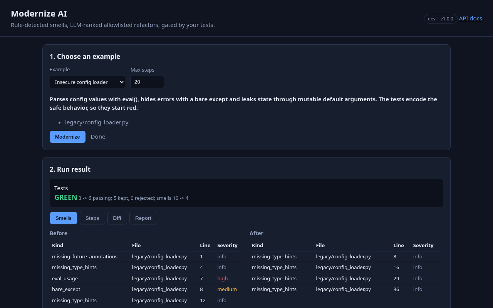
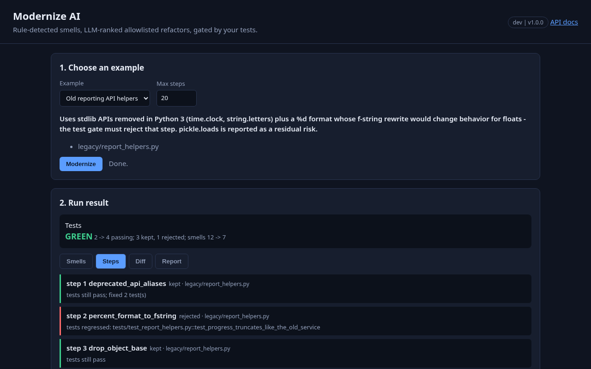
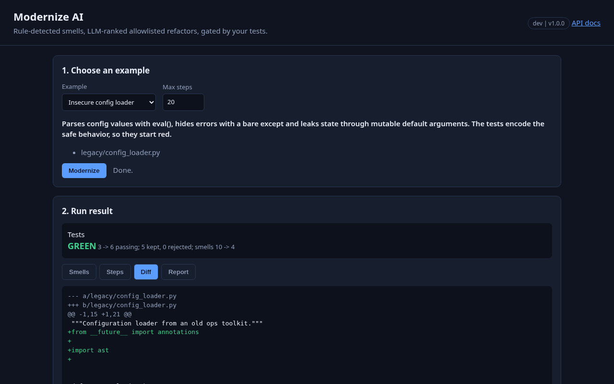
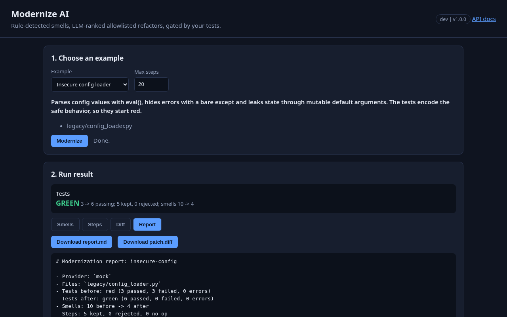
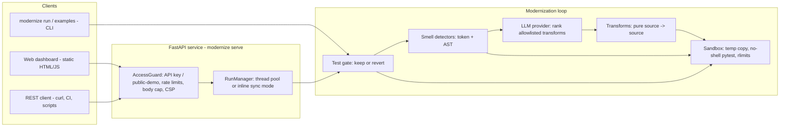
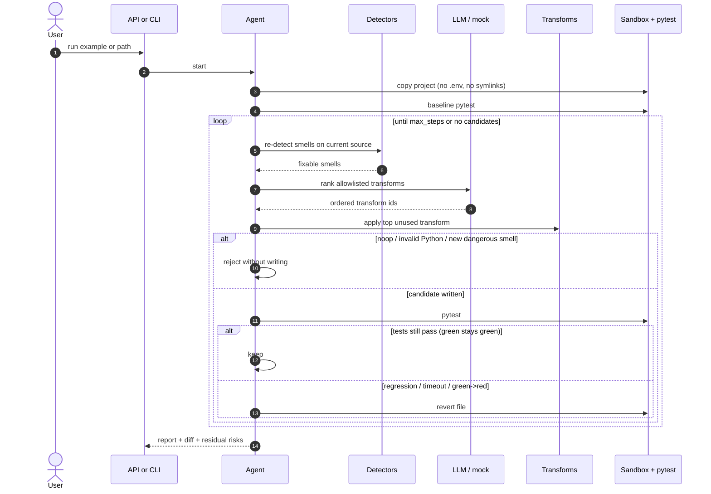

# Modernize AI - Legacy Code Modernization Agent

[](https://github.com/bharatkumar00797/modernize-ai-legacy-code/actions/workflows/ci.yml)


**Modernize AI is an AI/LLM agent that modernizes legacy Python while preserving behavior.**
Deterministic analyzers find smells, an LLM (or a fixed offline policy) ranks allowlisted
transforms, each change is applied in a sandbox, and **your existing test suite decides**
whether the step is kept or reverted. Originals are never mutated.

It works fully offline by default with a deterministic **mock** provider, so demos, tests and
every deployment run without paid keys. Any OpenAI-compatible API (OpenAI, Groq, Ollama) can
be plugged in. Safety never depends on the model: the transform allowlist and the test gate
decide *what* can stay.



## Contents

- [The problem](#the-problem)
- [Features](#features)
- [Screenshots](#screenshots)
- [Architecture](#architecture)
- [How the modernization loop works](#how-the-modernization-loop-works)
- [Smell reference](#smell-reference)
- [Transform reference](#transform-reference)
- [Example outcomes](#example-outcomes)
- [LLM providers](#llm-providers)
- [Quick start](#quick-start)
- [REST API](#rest-api)
- [Security model](#security-model)
- [Deployment](#deployment)
- [Configuration](#configuration)
- [Project layout](#project-layout)
- [Testing](#testing)
- [Roadmap](#roadmap)
- [Contributing](#contributing)
- [License](#license)

## The problem

Legacy Python is expensive to touch: Python 2 print statements and `xrange`, `eval()` of
config values, bare `except:`, mutable default arguments, removed stdlib aliases, insecure
deserialization. Teams want modern idioms and safer APIs, but free-form LLM rewrites risk
subtle behavior changes — and the model has no obligation to keep your tests green.

Modernize AI keeps the dangerous part — changing source — behind an allowlisted set of pure
transforms (or an opt-in, strictly applied unified diff), runs every candidate in a sandbox,
and **reverts** any step that breaks parsing, introduces dangerous patterns, or makes a
previously passing test fail. The LLM only ranks candidates the rules already produced.

## Features

- **Closed keep/revert loop**: detect → rank → transform → test-gate → keep or revert.
  Ineffective or risky steps are undone before the next candidate.
- **Token + AST smell detectors**: 18 kinds, including detectors that still fire on
  unparseable Python 2 sources (print statements, `xrange`, `unicode`, `iteritems`, …).
- **Eleven pure transforms**: exact token/AST span edits; conservative no-op when unsure;
  each documents its behavioral risk. Opt-in model unified diffs go through the same gate.
- **Sandbox + test gate**: temp copy, symlink refusal, extension allowlist (`.env` never
  copied), protected tests/config, fixed no-shell `pytest` argv, scrubbed env, timeout,
  rlimits, optional `unshare -rn`, results parsed only from the last short-summary block.
- **Offline by default**: mock provider turns all 3 packaged examples green (including a
  deliberate f-string rewrite that the gate rejects).
- **REST API + dashboard**: FastAPI with API-key / dev / public-demo modes, live smell
  tables, step timeline, colored diff, Markdown report; hardened multi-platform deploy.

## Screenshots

Dashboard deep links use `#run=<id>&tab=<name>` (`smells`, `steps`, `diff`, `report`).

| Smell table (before / after) | Step timeline (kept / rejected) |
| --- | --- |
|  |  |

| Colored unified diff | Markdown report |
| --- | --- |
|  |  |

## Architecture



| Layer | Module | Responsibility |
| --- | --- | --- |
| Interfaces | `cli.py`, `api/` | CLI, REST API, dashboard, auth, rate limiting, run lifecycle |
| Orchestration | `agent/loop.py` | detect → rank → apply → gate → keep/revert; progress events |
| Analysis | `smells.py`, `transforms.py` | 18 smell kinds, 11 allowlisted pure transforms |
| Decision | `llm/` | mock + OpenAI-compatible ranking; untrusted-data wrapping |
| Execution | `sandbox.py`, `agent/patch.py` | isolated workspace, pytest gate, strict unified-diff applier |
| Domain | `models.py`, `ingest.py`, `report.py` | strict pydantic models, packaged examples, Markdown/JSON report |
| Config | `config.py` | `MODERNIZE_*` provider and sandbox settings |

## How the modernization loop works



1. **Ingest.** Load a packaged example id, a project directory, or a single `.py` file.
   `modernize.json` is validated with `extra=forbid`. Targets must exist inside the root and
   must not be protected paths.
2. **Sandbox.** The project is copied into a temp workspace. Symlinks are refused, only
   allowlisted extensions are copied (so `.env` never lands), size caps apply, and tests /
   pytest config / `modernize.json` are protected from writes.
3. **Baseline.** Fixed argv `python -m pytest …` runs with a scrubbed env, timeout, CPU/FSIZE
   rlimits and optional `unshare -rn`. Results are parsed only from the **last** short-summary
   block so test stdout cannot fake `PASSED` lines.
4. **Detect.** Token detectors catch Python 2 constructs even when the file does not parse.
   Once it parses, AST detectors find `%` formatting, bare except, mutable defaults, `eval` /
   `exec`, pickle/marshal/`yaml.load`, `shell=True`, deprecated modules, and more.
5. **Rank.** Smells map to allowlisted transforms via `FIXES`. The provider returns an ordered
   list of transform ids; hallucinated ids are dropped. Invalid replies get one corrective
   retry, then a rule-order fallback. Provider errors also fall back.
6. **Transform.** One unused transform is applied as a pure `source → source` edit on exact
   spans. Opt-in model diffs (`MODERNIZE_ALLOW_MODEL_DIFFS`) go through a strict patch applier
   (exact context, path must match, no fuzz) and the same gate.
7. **Gate.** Reject if the file is unchanged, no longer parses, or newly contains eval/exec/
   pickle/shell smells. Otherwise write, run tests, and **revert** on timeout, any regression,
   or a green suite turning red. A red suite is allowed to improve.
8. **Report.** Markdown + JSON summarize smells before/after, kept and rejected steps with
   snippets, newly passing / would-have-broken tests, residual risks and the full diff.

## Smell reference

| Kind | How detected | Typical fix |
| --- | --- | --- |
| `py2_print` | token | `py2_print_to_function` |
| `py2_xrange` | token | `xrange_to_range` |
| `py2_unicode` | token (`unicode` / `basestring` / `unichr`) | `unicode_to_str` |
| `py2_dict_iter` | token (`iteritems` / `itervalues` / `iterkeys` / `has_key`) | `dict_iter_to_view` |
| `percent_format` | AST | `percent_format_to_fstring` |
| `bare_except` | AST | `bare_except_to_exception` |
| `mutable_default` | AST | `mutable_default_to_none` |
| `eval_usage` | AST | `eval_to_ast_literal` |
| `exec_usage` | AST | residual risk (no auto-fix) |
| `insecure_deserialization` | AST (`pickle` / `marshal` / `yaml.load`) | residual risk |
| `assert_validation` | AST (non-test files) | residual risk |
| `shell_injection` | AST (`os.system` / `shell=True`) | residual risk |
| `deprecated_api` | token (`time.clock`, `os.getcwdu`, `string.letters`, …) | `deprecated_api_aliases` |
| `deprecated_module` | AST (`imp`, `optparse`, `cgi`, …) | residual risk |
| `explicit_object_base` | AST | `drop_object_base` |
| `missing_type_hints` | AST | residual (not auto-generated) |
| `missing_future_annotations` | AST | `add_future_annotations` |
| `syntax_error` | parse failure | fixed by earlier Py2 transforms |

## Transform reference

| Transform | What it does | Behavioral risk |
| --- | --- | --- |
| `py2_print_to_function` | `print x` / `print >>f, x` → `print(...)` | trailing-comma softspace ≈ `end=" "` |
| `xrange_to_range` | `xrange` → `range` | identical for iteration on Py3 |
| `unicode_to_str` | `unicode`/`basestring`/`unichr` → `str`/`chr` | bytes-vs-text distinctions may change |
| `dict_iter_to_view` | `.iteritems()` → `.items()` | views are live |
| `bare_except_to_exception` | `except:` → `except Exception:` | `BaseException` no longer swallowed |
| `mutable_default_to_none` | `[]`/`{}` defaults → `None` + guard | shared-state callers see fresh objects |
| `eval_to_ast_literal` | `eval(x)` → `ast.literal_eval(x)` | expressions like `1+x` now raise |
| `percent_format_to_fstring` | `"%s" % x` → `f"{x}"` (simple cases) | `%d` truncates floats; `{x:d}` raises |
| `deprecated_api_aliases` | `time.clock` → `perf_counter`, … | wall time vs CPU time on POSIX |
| `drop_object_base` | `class X(object)` → `class X` | none on Py3 |
| `add_future_annotations` | insert `from __future__ import annotations` | `__annotations__` become strings |
| `model_diff` | opt-in unified diff from a real model | same gate; disabled by default |

## Example outcomes

Numbers from the offline mock provider (also asserted by CI and the Docker smoke test):

| Example | Before | After | Kept / rejected | Notable |
| --- | --- | --- | --- | --- |
| `py2-style-utils` | 0 passing (import error) | **5/5 green** | 7 kept / 0 rejected | print, xrange, unicode, dict iters, %-format, object base, future annotations |
| `insecure-config` | 3/6 | **6/6 green** | 5 kept / 0 rejected | `eval`→`literal_eval`, mutable defaults, bare except |
| `old-api-helpers` | 2/4 | **4/4 green** | 3 kept / **1 rejected** | `deprecated_api_aliases` fixes the suite; `percent_format_to_fstring` rejected (`%d` on float); `pickle.loads` left as residual risk |

## LLM providers

| Provider | When to use | Configuration |
| --- | --- | --- |
| `mock` (default) | demos, CI, offline development | nothing to set |
| `openai` | any OpenAI-compatible `/chat/completions` API | `MODERNIZE_BASE_URL`, `MODERNIZE_API_KEY`, `MODERNIZE_MODEL` |

```bash
# OpenAI
export MODERNIZE_PROVIDER=openai
export MODERNIZE_BASE_URL=https://api.openai.com/v1
export MODERNIZE_MODEL=gpt-4o-mini
export MODERNIZE_API_KEY=sk-...

# Groq
export MODERNIZE_PROVIDER=openai
export MODERNIZE_BASE_URL=https://api.groq.com/openai/v1
export MODERNIZE_MODEL=llama-3.3-70b-versatile
export MODERNIZE_API_KEY=gsk_...

# Ollama (local, no key needed)
export MODERNIZE_PROVIDER=openai
export MODERNIZE_BASE_URL=http://localhost:11434/v1
export MODERNIZE_MODEL=llama3.1
export MODERNIZE_API_KEY=ollama
```

Public-demo mode always forces the mock, whatever the environment says. The model runs at
temperature 0 with retries on 429 / 5xx; it only ever returns allowlisted transform ids (or,
when `MODERNIZE_ALLOW_MODEL_DIFFS=true`, a unified diff that must apply exactly).

## Quick start

```bash
git clone https://github.com/bharatkumar00797/modernize-ai-legacy-code.git
cd modernize-ai-legacy-code
python -m venv .venv && source .venv/bin/activate
pip install -e ".[dev]"

modernize examples
modernize run py2-style-utils
modernize run insecure-config
modernize run old-api-helpers          # watch the %d f-string get rejected
modernize serve --dev                  # dashboard on http://127.0.0.1:8000
```

## REST API

Interactive docs are at `/docs` (OpenAPI at `/openapi.json`). The HTTP API accepts **packaged
example ids only** (no arbitrary uploads); the local CLI still accepts directories and files.

| Method | Path | Purpose |
| --- | --- | --- |
| GET | `/healthz` | Liveness + version |
| GET | `/api/config` | Access mode, provider name, limits (never credentials) |
| GET | `/api/examples` | Packaged legacy examples |
| GET | `/api/transforms` | Allowlisted transform catalogue |
| POST | `/api/runs` | `{"example","max_steps?","provider?"}` → 202 async / 200 sync |
| GET | `/api/runs` | Runs visible to the caller |
| GET | `/api/runs/{id}` | Run detail + report snapshot |
| GET | `/api/runs/{id}/events?since=N` | Event timeline after cursor `N` (polling) |
| GET | `/api/runs/{id}/report.md` | Markdown report (after finish) |
| GET | `/api/runs/{id}/patch.diff` | Unified diff (after finish) |

```bash
curl -s -X POST localhost:8000/api/runs -H 'Content-Type: application/json' \
  -d '{"example":"py2-style-utils"}'
curl -s "localhost:8000/api/runs/<id>/events?since=0"
curl -s "localhost:8000/api/runs/<id>/report.md"
```

### Access modes

| Mode | When | Behaviour |
| --- | --- | --- |
| **api-key** | `MODERNIZE_API_KEYS` set | `X-API-Key` or `Authorization: Bearer` required; callers may use the configured LLM provider |
| **dev** | `MODERNIZE_DEV_MODE=true` / `serve --dev` | No auth; full access; localhost only |
| **public-demo** | neither | Anonymous, packaged examples + mock only, per-client (hashed IP) ownership |

Runs use a bounded background worker pool (`POST` → `202`, poll events). With
`MODERNIZE_SYNC_RUNS=true` (automatic on Vercel / AWS Lambda) they finish inside the request
(`200` with the finished report + full event list).

### Error codes

| Status | When |
| --- | --- |
| `401` | missing or unknown API key |
| `403` | public-demo forbids real providers |
| `404` | unknown run |
| `409` | report/patch requested before the run finished |
| `413` | request body over 64 KB (Content-Length or streamed) |
| `422` | unknown example, invalid input, or `max_steps` above the cap |
| `429` | general or run-creation rate limit exceeded (`Retry-After`) |
| `503` | run queue full |

## Security model

An agent that rewrites source and executes tests needs hard boundaries. Modernize AI layers
several guards; none of them is a silver bullet.

| Layer | Control |
| --- | --- |
| Model output | Returns only allowlisted transform **ids** (or an opt-in unified diff). Hallucinated ids are filtered; invalid / erroring replies fall back to rule order |
| Untrusted source | File contents and smell snippets are wrapped in `<untrusted-data>` with `<` escaped so content cannot close the block or look like instructions |
| Transform allowlist | Only the 11 rule transforms (+ opt-in `model_diff`). Unknown ids never reach `apply` |
| Test gate | Noop / invalid Python / new eval-exec-pickle-shell → reject. Regression or green→red → **revert**. Previously passing tests must stay passing |
| Sandbox | Temp copy; symlinks refused; extension allowlist (`.env` never copied); size caps; writes only to existing `.py` outside protected paths; fixed no-shell pytest argv; scrubbed env; timeout + killpg; CPU/FSIZE rlimits; `unshare -rn` when available; results from last short-summary only |
| Strict patches | Model diffs require exact context, matching paths, no fuzz; same gate as rule transforms |
| HTTP | API keys as SHA-256 digests compared with `hmac.compare_digest`; sliding-window rate limits (general + stricter run creation); pydantic `extra=forbid`; 64 KB body cap (header and streamed); strict CSP + security headers; `no-store` on `/api`; env-driven CORS; right-most `X-Forwarded-For` only behind `MODERNIZE_TRUST_PROXY` |
| Public demo | Mock forced; packaged examples only; ownership scoped to `anon:` + `sha256(client_ip)[:12]` |
| Dashboard | All server data rendered with `textContent` (no HTML sinks) |
| Container | Non-root uid 10001, read-only rootfs, tmpfs `/tmp`, `cap_drop: ALL`, `no-new-privileges`, pids / mem / CPU limits |
| Secrets | Provider keys only from the environment; never returned in any response (tested) |

**Residual risks** (stated honestly):

- The agent modernizes **copies**. It never pushes commits or mutates your working tree unless
  you deliberately apply the emitted `patch.diff`.
- State (runs, rate limits, ownership) lives **in memory** per process: lost on restart, and on
  serverless a follow-up request may land on a fresh instance and return `404`. Prefer a
  container platform for anything beyond a single-request demo.
- Transforms are **heuristics**. A real LLM may still rank a risky rewrite first; the test gate
  is the backstop, not model correctness. Smells without a transform (pickle, shell, missing
  hints) are reported as residual risks, not auto-fixed.
- `unshare -rn` is best-effort: inside hardened containers (`cap_drop` / `no-new-privileges`) it
  is often denied; the agent notes it and continues. Treat container hardening as the real
  network boundary there.
- Behind a reverse proxy without `MODERNIZE_TRUST_PROXY=true`, all public-demo visitors share
  one identity. With it set, trust only proxies you control.
- The mock provider is safe by construction; treat hosted-model output as advisory ranking only.

See [SECURITY.md](SECURITY.md) for how to report a vulnerability.

## Deployment

All container platforms build the same hardened, non-root image (`Dockerfile`) and probe
`/healthz`; the server listens on `$PORT`. Without API keys every deployment is a public demo.
Lock a deployment down by setting `MODERNIZE_API_KEYS` as a platform secret. Pytest is a
runtime dependency so the test gate works inside the image.

### Long-running container vs serverless

| | Container (Docker / Render / Fly / Railway) | Serverless (Vercel) |
| --- | --- | --- |
| Process lifetime | long-lived; background runs OK | per-request; use sync mode |
| Run store | in-memory for the life of the process | in-memory per instance |
| Best for | demos and small shared instances | quick public demos, single-request flows |

### Docker and docker compose

```bash
docker compose up --build --wait
python3 scripts/smoke_test.py http://127.0.0.1:8000   # all 3 examples end to end
```

Compose runs read-only with all capabilities dropped, a `tmpfs` for `/tmp`, and memory / pid
limits. The image health-checks `/healthz` and honours `$PORT`. `MODERNIZE_HOST_PORT` changes
the host port (compose only).

Hardened one-shot run:

```bash
docker build -t modernize .
docker run --rm -p 8000:8000 --read-only --tmpfs /tmp --cap-drop ALL \
  --security-opt no-new-privileges -e MODERNIZE_SYNC_RUNS=true modernize
```

### Render

`render.yaml` Blueprint: Docker runtime, free plan, health check on `/healthz`,
`MODERNIZE_PROVIDER=mock`, `MODERNIZE_TRUST_PROXY=true`. Connect the repo and Render applies
the Blueprint. Add secrets in the dashboard.

### Fly.io

```bash
fly launch --copy-config --no-deploy
fly deploy
```

`fly.toml` sets `PORT=8080` (= `internal_port`), a `/healthz` check and region `bom`.

### Railway

`railway.json` selects the Dockerfile builder, probes `/healthz` and restarts on failure.

### Vercel

`api/index.py` is the serverless entry; `vercel.json` bundles `src/modernize/**` (examples +
dashboard) and rewrites every path to the function. Runs execute in sync mode because functions
cannot keep background threads. Prefer a container platform for multi-step polling across
requests.

## Configuration

All settings are environment variables (see [`.env.example`](.env.example)).

| Variable | Default | Description |
| --- | --- | --- |
| `MODERNIZE_PROVIDER` | `mock` | `mock` (offline) or `openai` (any OpenAI-compatible API) |
| `MODERNIZE_MODEL` | `gpt-4o-mini` | Model name for the `openai` provider |
| `MODERNIZE_BASE_URL` | `https://api.openai.com/v1` | API base URL (Groq, Ollama, OpenRouter, vLLM, …) |
| `MODERNIZE_API_KEY` | empty | Provider key; sent as a Bearer token, never returned |
| `MODERNIZE_LLM_TIMEOUT` | `30` | Provider HTTP timeout (seconds) |
| `MODERNIZE_LLM_RETRIES` | `2` | Retries on 429 / 5xx |
| `MODERNIZE_ALLOW_MODEL_DIFFS` | `false` | Let a real model propose unified diffs (still gated) |
| `MODERNIZE_MAX_STEPS` | `20` | Default agent step budget |
| `MODERNIZE_TEST_TIMEOUT` | `60` | Pytest timeout inside the sandbox (seconds) |
| `MODERNIZE_ISOLATE_NETWORK` | `true` | Prefer `unshare -rn` when available |
| `MODERNIZE_API_KEYS` | empty | Comma-separated keys; enables `api-key` mode |
| `MODERNIZE_DEV_MODE` | `false` | No auth (localhost only); same as `serve --dev` |
| `MODERNIZE_CORS_ORIGINS` | empty | Comma-separated browser origins; empty = same-origin only |
| `MODERNIZE_RATE_LIMIT_PER_MINUTE` | `120` | `/api` requests per key or IP per minute |
| `MODERNIZE_RUN_LIMIT_PER_MINUTE` | `6` | Run-creation limit per key or IP per minute |
| `MODERNIZE_MAX_CONCURRENT_RUNS` | `2` | Background worker pool size |
| `MODERNIZE_MAX_QUEUED_RUNS` | `8` | Bounded queue (`503` when full) |
| `MODERNIZE_MAX_RUNS_KEPT` | `200` | In-memory run history (oldest evicted) |
| `MODERNIZE_MAX_STEPS_CAP` | `40` | Cap on requested `max_steps` per HTTP run |
| `MODERNIZE_TRUST_PROXY` | `false` | Use the right-most `X-Forwarded-For` hop |
| `MODERNIZE_SYNC_RUNS` | `false` (auto-on serverless) | Finish each run inside `POST /api/runs` |
| `MODERNIZE_HOST_PORT` | `8000` | Host port (docker-compose only; not read by the app) |
| `PORT` / `HOST` | `8000` / `127.0.0.1` (`0.0.0.0` in the container) | Listen address for `modernize serve` |

## Project layout

```
src/modernize/
  models.py       SmellKind, TransformKind, PlanStep, SuiteSnapshot, ModernizationReport
  smells.py       Token + AST detectors and FIXES map
  transforms.py   Eleven pure allowlisted source transforms
  sandbox.py      Temp copy, protected paths, no-shell pytest, rlimits
  ingest.py       Packaged examples + path/dir loading
  llm/            Mock + OpenAI-compatible providers (rank only)
  agent/          Loop (detect→rank→gate) + strict unified-diff applier
  report.py       Markdown / JSON modernization report
  cli.py          modernize examples | run | serve
  config.py       MODERNIZE_* provider and sandbox settings
  api/            FastAPI app, settings, auth + rate limits, middleware, jobs, static dashboard
  examples/       py2-style-utils, insecure-config, old-api-helpers
api/index.py      Vercel entrypoint
scripts/          smoke_test.py (stdlib end-to-end check)
tests/            pytest suite
docs/screenshots/ dashboard screenshots
```

## Testing

```bash
ruff check . && ruff format --check . && mypy && pytest
```

CI runs this on Python 3.11, 3.12 and 3.13 (including `modernize run` on every packaged
example), then builds the hardened container with `docker compose up --wait` and runs
`scripts/smoke_test.py` against it (all 3 examples).

## Roadmap

- `assert` → `raise` and `except X, e:` Python 2 syntax transforms
- LLM-proposed type hints gated by mypy inside the sandbox
- Per-test timing and flake detection in the report
- Optional persistent run store for multi-instance / serverless follow-ups

## Contributing

See [CONTRIBUTING.md](CONTRIBUTING.md). Please report security issues privately via
[SECURITY.md](SECURITY.md).

## License

[MIT](LICENSE)
